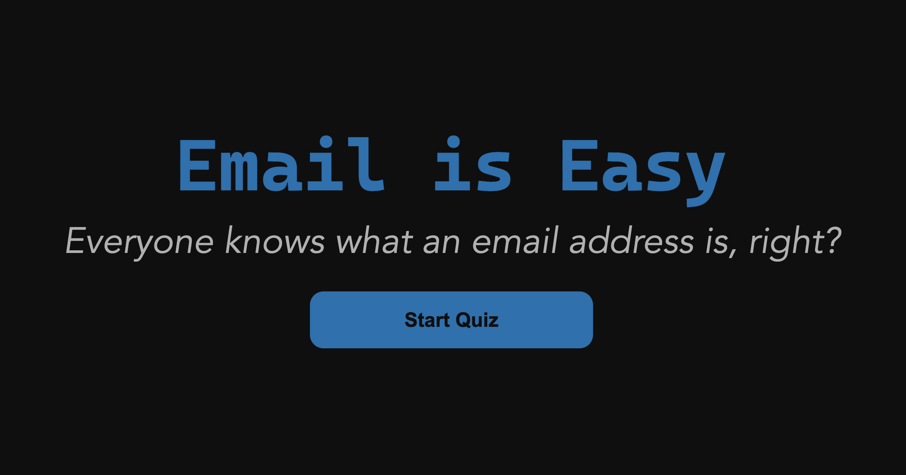

# Email is Easy

This is the code behind <https://e-mail.wtf>.

## Development

Run `bun install --frozen-lockfile` and `bun run build` to compile the TypeScript
into `public/out/`. Run `bun run dev` to rebuild when source files change.
Generated JavaScript is committed; commit updated bundles with source changes.
Source maps are not published.

To preview the site, run `python3 -m http.server --directory public 8000`.

## Deployment

The website files live in `public/`. Keep source code and repository-only files
outside that directory. The validator page lives at `/validator.html`.

On Laravel Cloud, use static serving with directory `public`. The committed
bundles mean no build or start command is needed. Enable edge-cache purging on
deployment so removed files do not remain available from the cache.
